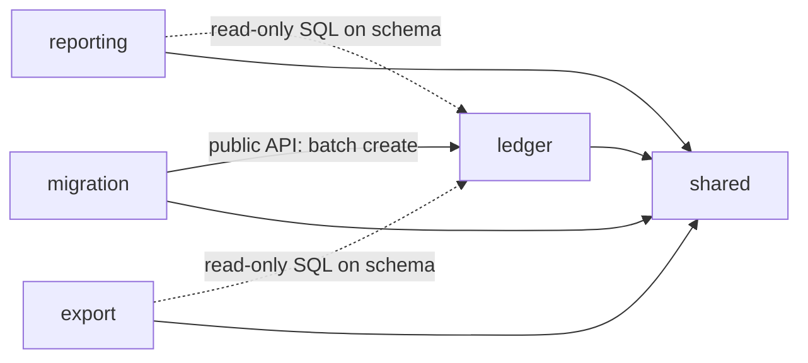

# ADR-0005: Architectural style & module boundaries

- **Status:** Accepted
- **Date:** 2026-11-10
- **Related:** QA-1, QA-2, QA-7, QA-9, QA-10, FR-X-4, ADR-0002, ADR-0003, ADR-0004, [architecture-options.md](../architecture-options.md) §1, WP-11, WP-12, WP-16, WP-35

## Context

- **Top 3 quality attributes** (WP-03): data safety, money correctness, correct migration. Then maintainability (QA-10): a solo maintainer with limited evenings.
- The domain model (WP-04) already has two **bounded contexts**: Core (accounts, bookings, categories) and Import (Money Manager terms, mappings). Import must be **deletable after cutover**.
- Much of the logic is **in the database by design** (er-mvp): `CHECK`s, composite FKs, the balance view, report `GROUP BY`s. Only a few rules live in code: closing rules (ADR-0003 A8), correction = target − current balance, transfer pairing and mapping (migration), idempotent capture (WP-35).
- Reports must stay fast at 10× data (S-9.1) without caches (ADR-0003 rule 6).
- The tech stack isn't chosen yet (WP-12). This ADR must work for every candidate in the options paper.

## Options considered

From [architecture-options.md](../architecture-options.md) §1:

- **A: Layered monolith.** Fast start. Boundaries erode, and the migration code can't be cleanly removed.
- **B: Modular monolith, layered inside each module.** Clear boundaries, but the few real rules sit in services next to plumbing.
- **C: Hexagonal everywhere.** Uniform, but ports around read-only `GROUP BY` queries add ceremony without protecting anything.
- **D: Modular monolith, hexagonal only where there is real logic, CQRS-lite for reads.** Chosen.

Module cut: **ledger / reporting / migration / export**, chosen over finer modules (accounts, categories, bookings separately; they share invariants and would cross each other's boundaries constantly) and over a coarse "core + migration" split (mixes read and write concerns).

## Decision

### 1. Style

A **modular monolith**: one deployable, one database, split into modules by domain. Modules with real domain rules (**ledger**, **migration**) have a **hexagonal core**; read-only modules (**reporting**, **export**) are **CQRS-lite**: SQL straight into view models, no domain objects. No microservices, no domain events, no message bus: modules call each other synchronously through public APIs.

### 2. Modules

| Module | Responsibility | Owns (tables) | Style |
|---|---|---|---|
| **shared** | Tiny shared kernel: `Money` (integer cents, WP-21), date helpers, German formatting. **No business logic, no dependencies.** | — | plain library |
| **ledger** | Accounts, categories, bookings, balances. Capture, edit, delete, corrections, closing, archiving. All write rules of ADR-0002 to ADR-0004. | `account`, `category`, `booking`, balance view(s) | hexagonal |
| **reporting** | Income/expense views, balance overview, transaction list and search | none (read-only) | CQRS-lite |
| **export** | Full data export (FR-X-4), streamed as CSV/JSON | none (read-only) | CQRS-lite |
| **migration** | One-time Money Manager migration: parse CSV, pair transfers, apply the migration file (ADR-0004), preview, commit, lineage. **Deleted after cutover.** | `import_source_row` | hexagonal |

Backups are **not** an app module. They're a deployment concern (WP-15, sidecar or job), so they keep working when the app is broken (QA-7).

### 3. Dependency rules

| From → To | Allowed? |
|---|---|
| any → `shared` | ✅ |
| `shared` → any | ❌ |
| `migration` → `ledger` **public API** | ✅ the only way migration creates data |
| `migration` → `ledger` tables / internals | ❌ (exception: the FK `import_source_row.booking_id → booking`) |
| `reporting`, `export` → `ledger` **tables and views, read-only** | ✅ accepted coupling to the schema (CQRS-lite) |
| `reporting`, `export` → `ledger` write API or internals | ❌ |
| `ledger` → `reporting`, `export`, `migration` | ❌ ledger knows nothing about its readers or about Money Manager |
| `reporting` ↔ `export` | ❌ independent |
| anything → `migration` | ❌ so it can be deleted without breaking a build |

### 4. Inside the hexagonal modules

**ledger:**

- **Domain** (no framework, no SQL): a **small rich domain**. `Booking` can only be created valid, through one factory per kind (income, expense, transfer, correction), mirroring ADR-0002's invariants. `Account.close(currentBalance, date)` enforces the closing rules. A correction is computed from target and current balance. Uses `Money` from `shared`.
- **Application services:** one per use case (capture, edit, delete, correct balance, close account, archive category, batch create for migration). They load, call the domain, save, and **own the DB transaction**.
- **Ports:** repositories for accounts, categories and bookings; a balance query port (implemented with the balance view).
- **Adapters:** persistence (all of ledger's SQL lives here), web (UI/API for capture and master data).

**migration:**

- **Domain:** source rows, transfer pairing, mapping rules, validation, completeness check (S-2.1).
- **Ports:** CSV source reader, migration-file reader/writer, ledger (calls ledger's public batch API), lineage store.
- **Adapters:** CSV parser (WP-22), migration-file format (WP-16), web (wizard), persistence for `import_source_row`.

The whole migration commit is **one DB transaction** spanning ledger's batch create and the lineage rows: all or nothing (QA-2).

### 5. Read-only modules

`reporting` and `export` run SQL against ledger's tables and views and map rows directly into view models or output streams. They never instantiate ledger domain objects. Balances always come from ledger's **balance view**, so the ADR-0002 rule still lives in one place.

### 6. Where SQL lives

| SQL | Lives in |
|---|---|
| Schema, constraints, balance view | Migrations (WP-20), owned by ledger (`import_source_row` by migration) |
| Writes and domain loads | ledger's persistence adapter |
| Reports, list, search | reporting module |
| Export queries | export module |
| Lineage | migration's persistence adapter |

### 7. Enforcement

- An **architecture test** in the build checks §3 and §4 (e.g. "ledger domain imports no framework or SQL package", "nothing imports migration", "reporting doesn't call ledger's application services"). The tool depends on WP-12 (ArchUnit/Spring Modulith, go-arch-lint, dependency-cruiser, …).
- Plus language visibility wherever it's free (package-private, `internal`).
- Read-only access of reporting/export is also enforced in the database: they use a connection or role with **`SELECT` only** (decided with the stack, WP-12/WP-32).

## Consequences

- **Positive:**
  - The few real rules sit in a framework-free domain and are unit-testable without a DB; everything else stays plain SQL.
  - Reports are as fast as the SQL (QA-9), with no mapping through domain objects.
  - The migration goes through the same rules as daily capture (closing rules included), and its commit is atomic (QA-2).
  - After cutover, deleting the `migration` module and dropping `import_source_row` touches nothing else.
  - Boundaries are executable, like the DB constraints.
- **Negative / accepted trade-offs:**
  - reporting and export are **coupled to ledger's schema**. A column rename in ledger can break them; their tests must run against the real schema.
  - Two styles (hexagonal and CQRS-lite) to keep apart.
  - Ports in ledger and migration add some interfaces and mapping code.
  - The migration must order its calls (create accounts open → book → close), because it goes through ledger's rules.
- **Follow-ups:**
  - WP-12: pick the architecture-test tool and the package/folder layout per module.
  - WP-13: C4 container diagram; a component view per module can reuse §2–§4.
  - WP-16: migration pipeline in terms of these ports; ledger's batch API.
  - WP-21: `Money` in `shared`.
  - WP-26: API contract per module's web adapter.
  - WP-35: capture use cases and idempotency in ledger's application services.
