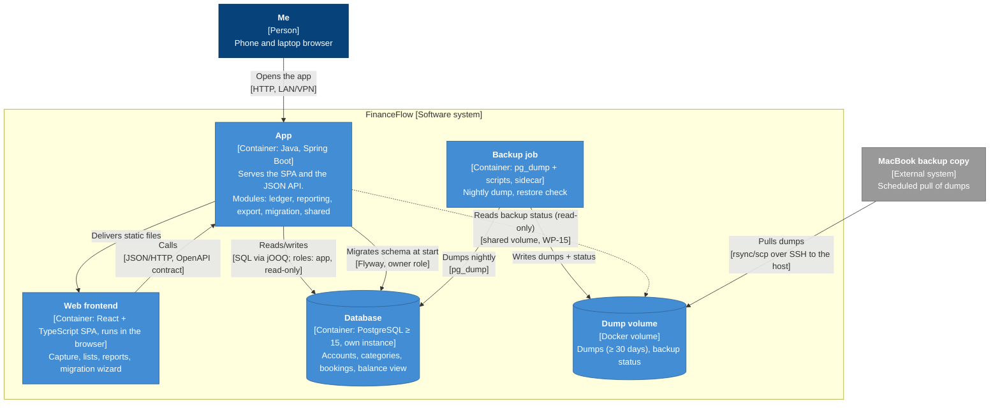
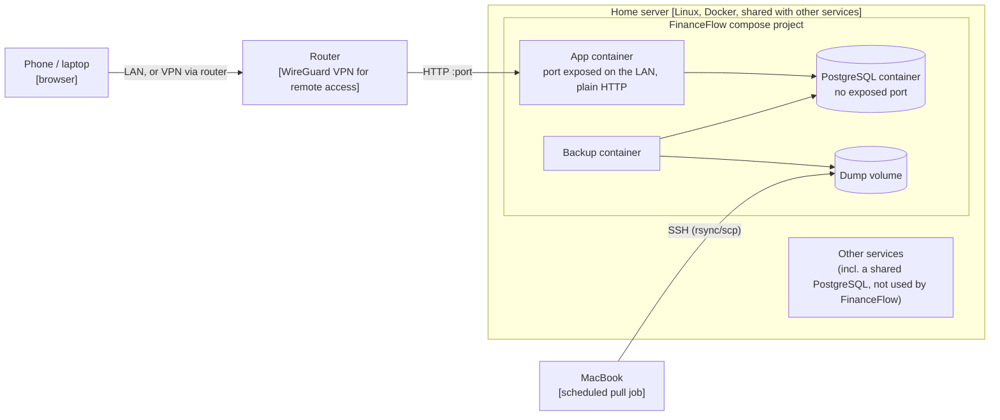

# C4 level 2: Containers

> **What this shows:** the runtime building blocks of FinanceFlow (things that run or store data), their technology and how they talk. Plus a small deployment view (where they run).
> **What it omits:** modules inside the app (ADR-0005; Spring Modulith can generate that component view later), tables (er-mvp), the exact backup mechanics (WP-15).
> **Status:** WP-13, 2026-11-10. Decisions: ADR-0005, ADR-0006, S-7.x.

## Containers

| Container | Technology | Responsibility | Decided in |
|---|---|---|---|
| Web frontend | React, TypeScript, Vite, TanStack Query, Recharts | All UI. Talks only to the app's JSON API | ADR-0006 |
| App | Java LTS, Spring Boot, jOOQ, Flyway, Spring Modulith | API, domain rules, reports, export, migration; serves the SPA's static files | ADR-0005, ADR-0006 |
| Database | PostgreSQL ≥ 15, **own instance** in FinanceFlow's compose file (an external instance also works via env, C-2) | The data. Enforces the invariants from er-mvp | ADR-0006, WP-13 |
| Backup job | Sidecar container with `pg_dump` and scripts | Nightly dump, restore check into a throwaway DB, status file. Independent of the app (QA-7) | ADR-0006, WP-15 |
| Dump volume | Docker volume / host directory | Dumps and backup status; the MacBook pulls from here | S-7.1, WP-15 |

Notes:

- **One app container** serves both the SPA and the API (ADR-0006), so there's no separate web server.
- **Memory budget** (ADR-0006): app + backup job ≤ 300 MB. The own PostgreSQL instance comes on top (roughly 50–150 MB when tuned small).
- **The app reads backup status** to show "last backup" and "last off-machine copy > 3 days" (S-7.1). How the MacBook's pull is detected (e.g. a marker file) is decided in WP-15.
- **Why an own PostgreSQL** instead of the existing shared container: isolation from other services' failures and upgrades, backups and app move as one unit (QA-7, QA-14). Costs ~50–150 MB of RAM.

## Deployment (home server today)

- **No reverse proxy**: the app exposes one port on the LAN, plain HTTP. Remote access only via the router's VPN (C-9). TLS isn't needed for the MVP. Passkeys (WP-14, P2) would need HTTPS, so revisit then.
- **PostgreSQL exposes no port** to the LAN; only the app and the backup job reach it on the compose network.
- **Nothing is host-specific** (C-1, QA-14): another machine with Docker runs the same compose file.
