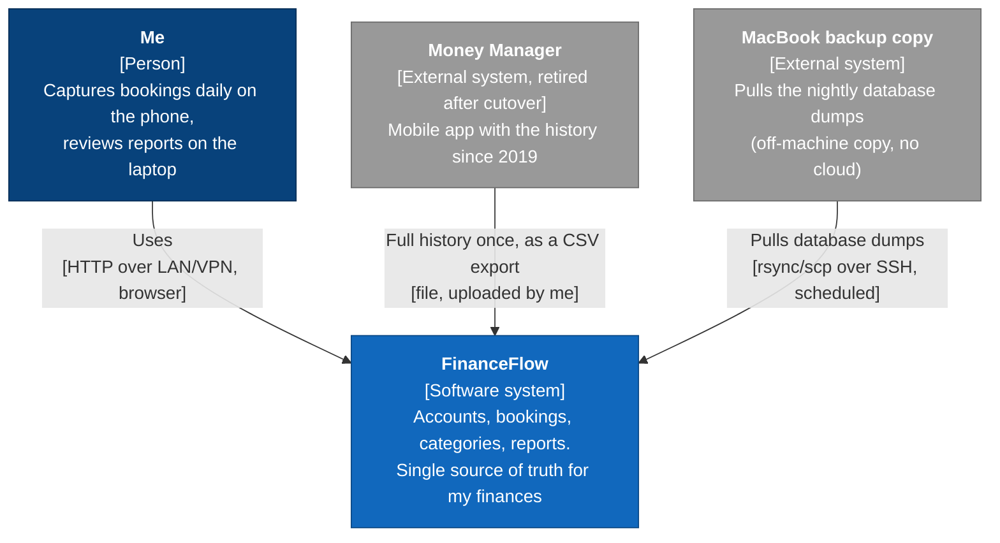

# C4 level 1: System context

> **What this shows:** FinanceFlow as one box, the people who use it and the systems it exchanges data with.
> **What it omits:** everything inside FinanceFlow (see [c4-container.md](c4-container.md)), and infrastructure: home server, router, VPN, Docker. Those are *where* things run, not *what* talks to what, so they're in the deployment view at the end of the container diagram.
> **Status:** WP-13, 2026-11-10. Decisions: ADR-0005, ADR-0006, quality scenarios S-7.x.

## Notes

- **Money Manager has no live connection.** The CSV export is a file I upload in the migration wizard. After cutover, Money Manager and the migration module are gone (ADR-0005).
- **The MacBook pulls**: FinanceFlow never pushes data anywhere, and nothing at runtime talks to the internet (C-4).
- **One user** (C-3). No login in the MVP: being on the LAN or VPN is the only protection (C-9).
