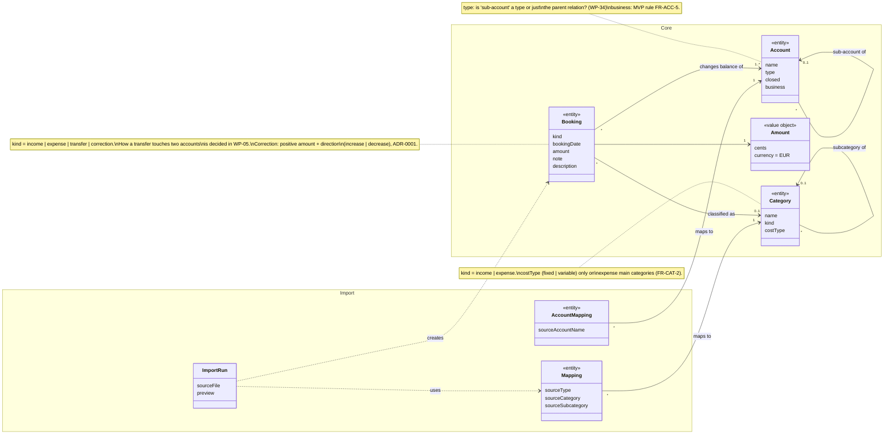

# Domain model (conceptual)

> **What this shows:** the core concepts of FinanceFlow and how they relate, in the terms of the [glossary](../domain/glossary.md).
> **What it omits:** IDs, foreign keys, data types and tables (that's the ER diagram, WP-09); P2/P3 concepts (standing orders, projections, ETFs).
> **Status:** WP-04 done. Money is decided in [ADR-0001](../adr/0001-money-representation.md). Open decisions are marked as notes and get resolved in WP-05 (transfers), WP-07 (categories) and WP-34 (accounts).

## Decisions (WP-04)

| Topic | Decision | Why |
|---|---|---|
| Entity vs. value object | **Account, Booking, Category** are entities: they keep their identity when attributes change (renaming!). **Amount** is a value object: defined only by its value, immutable. | FR-CAT-3: renaming a category must not split history |
| Aggregates | **Small aggregates.** An account does **not** contain its bookings; a booking only references its account. The balance is a query, not a list in memory. Whatever must be saved atomically (e.g. both sides of a transfer, if it has two) forms one aggregate → WP-05. | Capturing one coffee must not load and lock 2,600 bookings |
| Bounded contexts | **Core** (accounts, bookings, categories) and **Import** (Money Manager terms, mappings, import runs) are separate. Import depends on Core, never the other way round. Import translates Money Manager's quirks into clean bookings (anti-corruption layer). | MM's "Category" sometimes means an account; after cutover, Import can be deleted without touching Core |
| Naming | Code term **`Booking`** instead of `Transaction`. | Avoids confusion with database transactions (`@Transactional`) |

## Reading notes

- **Account** has an optional parent: one level only (FR-ACC-1). The group balance is computed, so there's no "AccountGroup" class.
- **Balance** isn't in the diagram on purpose: it's derived from bookings.
- **Booking → Account `1..*`** covers both cases (one account for income/expense, two for a transfer) without deciding *how*. WP-05 replaces this with the real structure.
- **Booking → Category `0..1`**: transfers and corrections have no category; income and expenses always have one (FR-CAT-1).
- **ImportRun** has no `<<entity>>` marking: it may not need to be persisted at all (preview → confirm, then it's gone). Decide in WP-16.
