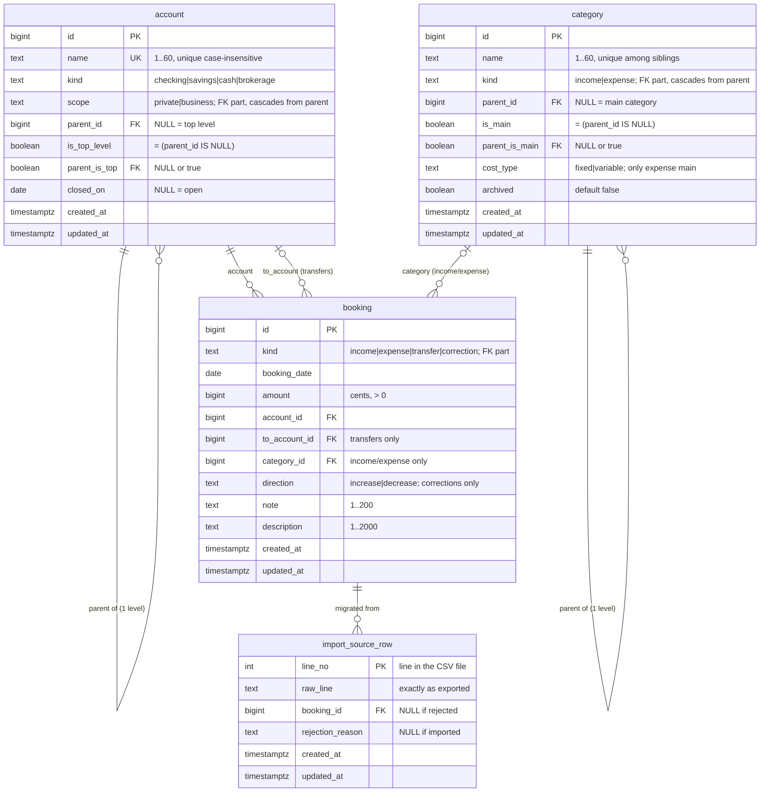

# ER diagram (MVP schema)

> **What this shows:** every MVP table with columns, keys, constraints and planned indexes, translated from the domain model and ADR-0001 to ADR-0004. Also which invariants the database enforces and which the code enforces.
> **What it omits:** P2 tables (standing orders, holdings, verified-balance log), the idempotency key for capture (WP-35), the audit trail (WP-35 ADR), exact DDL and migration order (WP-20).
> **Status:** WP-09, 2026-11-10.

## Conventions

| Topic | Decision | Why |
|---|---|---|
| Names | `snake_case`, singular table names (`account`, not `accounts`) | One row = one account; reads naturally in FKs (`account_id`) |
| Primary keys | `id bigint GENERATED ALWAYS AS IDENTITY` | Single DB, no distribution. Small and readable. Duplicate-capture protection (QA-12) is solved separately in WP-35 |
| Value sets | `text NOT NULL CHECK (x IN (…))`, no PG enum types | Changing a set is a constraint swap. Enum values can't be removed |
| Text | `text` + `CHECK (char_length(…) BETWEEN 1 AND n)` | Same speed as `varchar`; the CHECK also forbids empty strings, so "no value" is always `NULL` |
| Money | `amount bigint NOT NULL CHECK (amount > 0)`, cents | ADR-0001 |
| Dates | `booking_date date`; technical times `timestamptz` | A booking has no time of day (glossary) |
| Timestamps | `created_at`, `updated_at timestamptz NOT NULL DEFAULT now()` on every table | Debugging, ordering within a day. `updated_at` is set by the app (or a trigger, decided with the stack in WP-12) |
| FK deletes | `ON DELETE RESTRICT` (default `NO ACTION`) unless stated | History must never vanish as a side effect |

## Diagram



## Tables and invariants

### `account` (ADR-0003)

| # | Invariant | Enforced by |
|---|---|---|
| A1 | Name 1–60 chars, unique case-insensitive across all accounts (incl. closed) | `CHECK`; `UNIQUE INDEX ON account (lower(name))` |
| A2 | `kind`, `scope` from their fixed sets | `CHECK` |
| A3 | `is_top_level` is true exactly when there is no parent | `CHECK (is_top_level = (parent_id IS NULL))` |
| A4 | **One level only**: the parent is a top-level account | `parent_is_top`: `CHECK (parent_is_top)` + `CHECK ((parent_id IS NULL) = (parent_is_top IS NULL))`; FK `(parent_id, parent_is_top, scope) → account (id, is_top_level, scope)` |
| A5 | **Sub-account has the parent's scope** | Same FK: the child's own `scope` is an FK column. `ON UPDATE CASCADE` copies a parent's new scope to its children. A child can't change its scope alone |
| A6 | A parent with children can't become a sub-account | Same FK: the cascade would set the child's `parent_is_top = false` → `CHECK` fails |
| A7 | FK target for A4/A5 | `UNIQUE (id, is_top_level, scope)` (redundant with the PK, required by Postgres) |
| A8 | Close only at balance 0; no bookings after `closed_on`; no edit that changes a closed account's final balance; closing a parent closes the group (all-or-nothing) | **Code** (account/booking service, WP-35). Cross-row and aggregate rules; you are the only writer, and the migration inserts bookings before it closes accounts |

### `category` (ADR-0004)

| # | Invariant | Enforced by |
|---|---|---|
| C1 | Name 1–60 chars, unique among siblings (same kind, same parent), case-insensitive | `CHECK`; `UNIQUE INDEX ON category (kind, parent_id, lower(name)) NULLS NOT DISTINCT` (PostgreSQL ≥ 15; otherwise `coalesce(parent_id, 0)`) |
| C2 | `kind` ∈ {income, expense} | `CHECK` |
| C3 | One level only; subcategory has the parent's kind | Same pattern as A3–A7: `is_main`, `parent_is_main`, FK `(parent_id, parent_is_main, kind) → category (id, is_main, kind) ON UPDATE CASCADE`, `UNIQUE (id, is_main, kind)` |
| C4 | `cost_type` set ⇔ expense main category | `CHECK ((cost_type IS NOT NULL) = (kind = 'expense' AND is_main))` + value `CHECK` |
| C5 | FK target for B5 | `UNIQUE (id, kind)` |
| C6 | Delete only without bookings | FK from `booking` with `RESTRICT` |
| C7 | Archiving a main category archives its subcategories; archived categories not offered for capture | **Code** (multi-row, UI behavior) |

### `booking` (ADR-0001, ADR-0002, ADR-0004)

| # | Invariant | Enforced by |
|---|---|---|
| B1 | `kind` from its set; `amount > 0` | `CHECK` |
| B2 | Transfer ⇔ `to_account_id` set; `to_account_id ≠ account_id` | `CHECK` |
| B3 | Income/expense ⇔ `category_id` set | `CHECK` |
| B4 | Correction ⇔ `direction` set; value from its set | `CHECK` |
| B5 | **Booking kind = category kind** (FR-CAT-4) | FK `(category_id, kind) → category (id, kind)`, default `MATCH SIMPLE`, so it's skipped when `category_id` is `NULL` (transfers, corrections). `ON UPDATE NO ACTION`: a category with bookings can't change its kind |
| B6 | Note 1–200, description 1–2000 chars, or `NULL` | `CHECK` |
| B7 | No bookings on closed accounts after `closed_on` | **Code**, see A8 |
| B8 | No duplicate on retried capture (QA-12) | **WP-35** (idempotency key, not in this diagram) |

### `import_source_row` (Import context, QA-2)

| # | Invariant | Enforced by |
|---|---|---|
| I1 | Every CSV data line is recorded exactly once | PK `line_no` |
| I2 | A line became a booking **xor** was rejected with a reason | `CHECK ((booking_id IS NULL) <> (rejection_reason IS NULL))` |
| I3 | A transfer comes from two lines | Two rows with the same `booking_id` (no constraint needed) |
| I4 | Deleting a migrated booking later doesn't block | FK `booking_id → booking ON DELETE CASCADE` (lineage only, Import context) |

Completeness check (QA-2): `count(*) = number of data lines in the CSV`, and every booking created by the import run has ≥ 1 source row. The whole table can be dropped after cutover, and Core never reads it. Whether rejected lines can be committed at all is decided in WP-16. It contains personal data like every other table, so it's never exported to git.

## Derived data (no tables)

- **Balance** (ADR-0002/0003): one view, e.g. `account_movement`, with the signed amount per account side (`account_id`: income +, expense −, transfer −, correction ±; `to_account_id`: transfer +), and `account_balance` = `SUM` per account. Group balance = sum over parent + children. Computed on every read.
- **Main category of a booking**: `coalesce(category.parent_id, category.id)` (ADR-0004 rule 3).

## Indexes

| Index | Serves |
|---|---|
| `booking (kind, booking_date)` | Income/expense reports (FR-IE-1/2): `kind = ? AND booking_date` in a year → group by month × category. Add `INCLUDE (category_id, amount)` only if `EXPLAIN ANALYZE` shows it helps |
| `booking (account_id)` | Balance, transaction list by account, FK `RESTRICT` check |
| `booking (to_account_id) WHERE to_account_id IS NOT NULL` | Balance (transfer side). Partial: most bookings have no target |
| `booking (category_id) WHERE category_id IS NOT NULL` | Transaction list by category, merge (P2), FK `RESTRICT` check on category delete |
| `import_source_row (booking_id)` | Cascade on booking delete; lineage lookup |
| Unique indexes from A1, A7, C1, C3, C5 | Constraints |

Not indexed on purpose: text search (FR-TX-4) uses `ILIKE` with a sequential scan, and `account`/`category` parent FKs (tiny tables). Revisit threshold: a measured query > 100 ms (ADR-0003 rule 6).

## Changes against the ADR sketches

- **ADR-0003 sketch** used a separate `parent_scope` column with `CHECK (parent_scope = scope)`. A `CHECK` is evaluated per row immediately, but the FK cascade only runs at the end of the statement. So changing a group's scope works only if the same `UPDATE` also sets every child's `parent_scope` by hand. **Simplified**: the child's own `scope` is part of the FK, and `ON UPDATE CASCADE` propagates the parent's scope. One column less, and changing the parent's scope automatically changes the whole group. The decision itself (declarative, sub-account has the parent's scope) is unchanged.
- **ADR-0004 rule 4** planned a redundant `category_kind` column on `booking`. Not needed: the booking's own `kind` is the FK column (`(category_id, kind) → category (id, kind)`), and `MATCH SIMPLE` skips the check for transfers and corrections. One column less, same guarantee.

## Verifying the constraint tricks

[`er-mvp-checks/constraint-tricks.sql`](er-mvp-checks/constraint-tricks.sql) is a minimal schema plus statements labeled `expect OK` / `expect FAIL` for A4–A6, B5 and C1. Run it against a throwaway PostgreSQL 16:

```sh
docker run --rm -d --name ff-pgtest -e POSTGRES_PASSWORD=x postgres:16
docker exec -i ff-pgtest psql -U postgres -q < docs/diagrams/er-mvp-checks/constraint-tricks.sql
docker rm -f ff-pgtest
```

These become real migration tests in WP-20.
