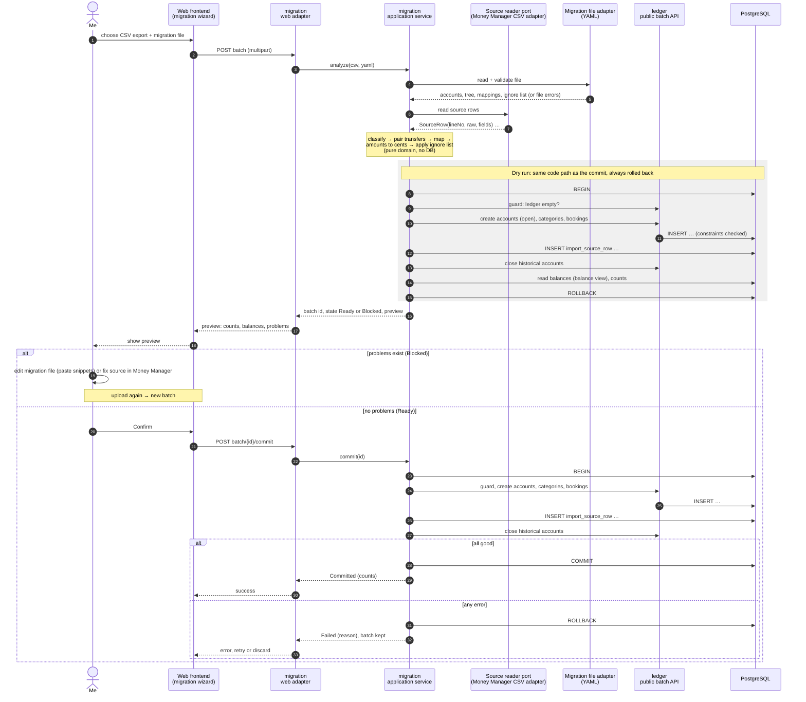

# Sequence: migration (upload → preview → confirm)

> **What this shows:** one trial or final run of the Money Manager migration, from upload to commit, across the ADR-0005 building blocks. Decisions: [ADR-0008](../adr/0008-migration-pipeline.md).
> **What it omits:** the reset script (runs before, outside the app), retries after a failed commit (same as the commit block), parsing details (CSV spec), the wizard's screens (WP-18/WP-30).
> **Status:** WP-16, 2026-11-10.

Notes:
- **Who owns which SQL** (ADR-0005): ledger writes accounts, categories and bookings; migration writes only `import_source_row`. Both run in the **same transaction**, which migration's application service opens.
- The **guard** "ledger empty" runs in the same transaction as the inserts, so nothing can slip in between check and write (single user, but free to get right).
