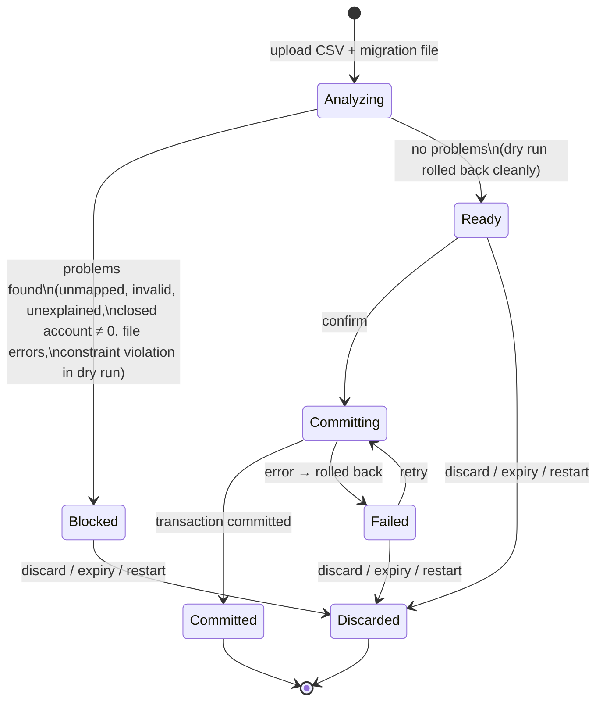

# State: import batch lifecycle

> **What this shows:** the states of one in-memory import batch ([ADR-0008](../adr/0008-migration-pipeline.md) §5).
> **What it omits:** the database state. A batch is never persisted; only a successful commit changes the DB.
> **Status:** WP-16, 2026-11-10.

| State | Meaning | DB changed? |
|---|---|---|
| Analyzing | Reading file and CSV, domain steps, dry run | No (dry run is rolled back) |
| Blocked | The preview has problems. **A batch can't be fixed in place**: fix the file or the source, then upload again (new batch) | No |
| Ready | Preview clean; Confirm enabled | No |
| Committing | The real commit transaction is running | In progress, atomic |
| Committed | Migration done; the batch is dropped from memory | **Yes, fully** |
| Failed | Commit rolled back (e.g. ledger not empty, DB error). Retry or discard | No |
| Discarded | Removed by me, after 1 h without use, or by an app restart | No |

Rules:
- **At most one batch** exists at a time; a new upload replaces the old one.
- Batches are **immutable** after analysis. Every change means a new upload, so the preview always describes exactly what would be committed.
